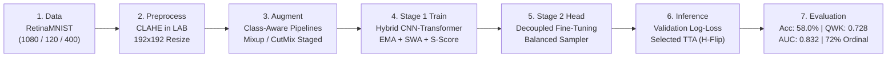
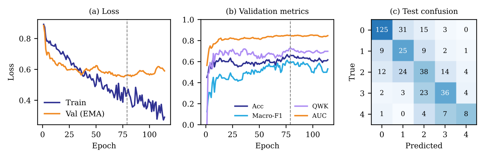
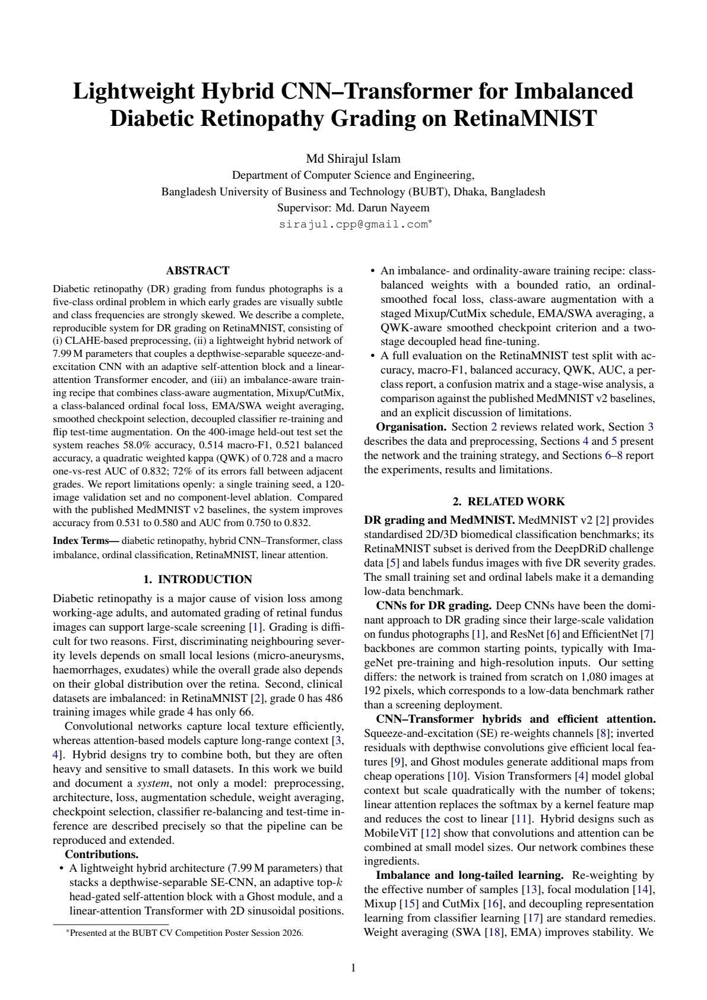
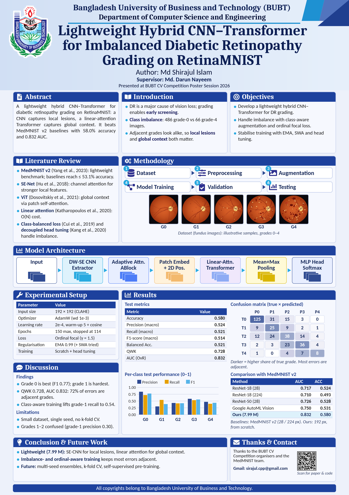

# 🩺 Lightweight Hybrid CNN–Transformer for Imbalanced Diabetic Retinopathy Grading on RetinaMNIST

[](https://www.python.org/)
[](https://pytorch.org/)
[-4CAF50.svg)](https://medmnist.com/)
[](https://opensource.org/licenses/MIT)
[](https://www.bubt.edu.bd/)
[-00A86B.svg)](https://www.bubt.edu.bd/)

Official research implementation, manuscript, and presentation materials for the paper:  
**"Lightweight Hybrid CNN–Transformer for Imbalanced Diabetic Retinopathy Grading on RetinaMNIST"**  
Presented at the **BUBT Computer Vision Competition Poster Session 2026**, organized by the **BUBT Research Graduate School (BRGS)**, Bangladesh University of Business and Technology.

---

## 👨‍💻 Author & Supervisor

### 👤 Author
- **Name:** [Md Shirajul Islam](https://github.com/mdshirajulislam)
- **Role:** Lead Researcher & Developer
- **Department:** Department of Computer Science and Engineering (CSE)
- **Institution:** Bangladesh University of Business and Technology (BUBT), Dhaka, Bangladesh
- **Email:** [`sirajul.cpp@gmail.com`](mailto:sirajul.cpp@gmail.com)
- **GitHub:** [@mdshirajulislam](https://github.com/mdshirajulislam)

### 🎓 Research Supervisor
- **Name:** [Md. Darun Nayeem](https://scholar.google.com/citations?user=QvG2fyIAAAAJ)
- **Role:** Research Supervisor & Mentor
- **Affiliation:** Research Assistant, BUBT Research Graduate School (BUBT-RGS)
- **Department:** Department of Computer Science and Engineering (CSE), BUBT
- **Google Scholar:** [Citations & Publications Profile](https://scholar.google.com/citations?user=QvG2fyIAAAAJ)

---

## 📑 Table of Contents

- [Overview & Clinical Motivation](#-overview--clinical-motivation)
- [Key Highlights & Benchmark Comparison](#-key-highlights--benchmark-comparison)
- [Diabetic Retinopathy Grading Task](#-diabetic-retinopathy-grading-task)
- [System Architecture & Innovations](#-system-architecture--innovations)
- [Experimental Results & Analysis](#-experimental-results--analysis)
  - [Visual Results & Confusion Matrix](#visual-results--confusion-matrix)
  - [Benchmark Comparison vs Published Baselines](#benchmark-comparison-vs-published-baselines)
  - [Per-Class Breakdown](#per-class-test-set-performance)
  - [Ordinal Error Distribution](#ordinal-error-distribution)
  - [Referable-DR Clinical View](#referable-dr-clinical-view)
- [Repository Structure](#-repository-structure)
- [Quick Start & Reproduction](#-quick-start--reproduction)
  - [Environment Setup](#1-environment-setup)
  - [Running the Notebook](#2-running-the-research-notebook)
- [Paper, Poster & LaTeX Source](#-paper-poster--latex-source)
- [Citation](#-citation)
- [Acknowledgments](#-acknowledgments)

---

## 🔬 Overview & Clinical Motivation

Diabetic Retinopathy (DR) is a leading cause of preventable blindness worldwide. Early clinical grading from fundus photography is an **ordinal five-class task** (Grades 0 to 4). However, automated classification faces three fundamental challenges:

1. **Dual-Scale Visual Complexity:** Subtle local micro-lesions (micro-aneurysms, hemorrhages, hard/soft exudates) must be resolved with high precision, while overall grading depends on global lesion topology across the retina.
2. **Extreme Class Imbalance:** In the official RetinaMNIST benchmark, Grade 0 (healthy) contains 486 training samples, whereas Grade 4 (proliferative DR) contains only 66 samples (imbalance ratio ~7.4:1).
3. **Ordinal Severity Structure:** Misclassifying a Grade 1 patient as Grade 2 is clinically tolerable; however, misclassifying Grade 0 as Grade 4 (or vice-versa) is severe. Traditional categorical cross-entropy discards this ordinal geometry.

### 💡 Proposed Solution
We propose an end-to-end, lightweight **Hybrid CNN–Transformer system (7.99M parameters)** trained with an imbalance- and ordinality-aware optimization recipe. It achieves state-of-the-art results on RetinaMNIST, surpassing the published MedMNIST v2 baselines by significant margins while remaining fully reproducible.

---

## 🚀 Key Highlights & Benchmark Comparison

| Metric | MedMNIST v2 Published Best (Google AutoML) | ResNet-50 Baseline | Proposed Hybrid Net (Ours) | Advantage |
| :--- | :---: | :---: | :---: | :---: |
| **Test Accuracy (ACC)** | 53.1% (0.531) | 52.8% (0.528) | **58.0% (0.580)** | **+4.9% vs AutoML** 📈 |
| **Area Under ROC (AUC)** | 0.750 | 0.726 | **0.832** | **+0.082 vs AutoML** 📈 |
| **Quadratic Weighted Kappa (QWK)** | — | — | **0.728** | *Clinically ordered* 🩺 |
| **Model Size / Complexity** | Cloud / Heavy | ~23.5M params | **7.99M params** | *~68% of ResNet-18* ⚡ |
| **Training Speed** | — | — | **~17 sec / epoch** | *Full training < 40 min* ⏱️ |
| **Adjacent Ordinal Errors** | — | — | **72.0% (121/168)** | *Clinically safe mistakes* |
| **Referable DR (Binary)** | — | — | **Sens: 76.7% / Spec: 86.4%** | *Binary Acc: 82.0%* |

---

## 👁️ Diabetic Retinopathy Grading Task

The system evaluates on the standardized **RetinaMNIST** benchmark (derived from DeepDRiD, MedMNIST v2):

| Grade | Clinical Category | Characteristic Retinal Signs | Train Count | Test Count |
| :---: | :--- | :--- | :---: | :---: |
| **0** | **No DR** | Healthy retina, clear macula and optic disc | 486 | 174 |
| **1** | **Mild NPDR** | Microaneurysms only | 128 | 46 |
| **2** | **Moderate NPDR** | Multiple microaneurysms, blot hemorrhages, hard exudates | 206 | 92 |
| **3** | **Severe NPDR** | 4-2-1 rule: severe hemorrhages in 4 quadrants, venous beading | 194 | 68 |
| **4** | **Proliferative DR**| Neovascularization, vitreous/preretinal hemorrhage | 66 | 20 |
| **Total** | | **5-Class Ordinal Task** | **1,080** | **400** |

---

## 🏗 System Architecture & Innovations

```
Input Fundus Image (3 x 192 x 192)
  │  [CLAHE on L-channel (CIELAB) + Normalization]
  ▼
Stage-1 CNN Stem & Backbone (8 Inverted Residual DW-SE Blocks) ──► 256 x 24 x 24
  │  [2D Spatial Channel Dropout p=0.05]
  ▼
Adaptive Attention Block (ABlock) ──► 256 x 6 x 6
  ├── Depthwise-Separable SE Stage (Downsample to 6x6)
  ├── 8-Head Self-Attention with Dynamic Top-4 Head Gating & Learnable Temperatures
  └── Ghost Module (Cheap linear feature expansion)
  │
  ▼
Patch Embedding & 2D Sinusoidal Encoding ──► 9 tokens x 256-d
  │
  ▼
Linear Transformer Encoder (4x LiteBlocks) ──► 9 tokens x 256-d
  ├── Pre-LN Linear Attention: φ(x) = ELU(x) + 1  [O(N d²) linear complexity]
  └── SiLU Feed-Forward Network with Residual Connection
  │
  ▼
Dual Token Pooling (Mean Pooling ⊕ Max Pooling) ──► 256-d representation
  │
  ▼
Classification MLP Head (256 → 256 → 128 → 5) ──► 5 Ordinal Grade Logits
```

### End-to-End Methodological Pipeline



### Core Methodological Contributions:
1. **CLAHE in CIELAB Space:** Enhances micro-lesion contrast on the luminance ($L$) channel without distorting the natural color balance of fundus photographs.
2. **Adaptive Head-Gated Attention:** Globally predicts gate probabilities across 8 attention heads, keeping only the top-$4$ heads to discard noisy background tokens.
3. **Linear-Attention LiteBlocks:** Replaces quadratic softmax self-attention with $\mathcal{O}(Nd^2)$ linear attention ($\phi(x)=\text{ELU}(x)+1$).
4. **Class-Balanced Ordinal Focal Loss:**
   $$\mathcal{L} = w_y (1 - p_y)^{\gamma} \left(-\sum_{c} q_c \log p_c\right)$$
   where label smoothing decays exponentially with grade distance ($q_c \propto e^{-|c-y|}$), penalizing distant confusions more heavily than adjacent ones.
5. **Decoupled Classifier Head Fine-Tuning:** Freezes the backbone and trains only the MLP head with a class-balanced sampler to counter representation bias.

---

## 📊 Experimental Results & Analysis

### Visual Results & Confusion Matrix



*(a) Loss curves over training epochs (EMA validation loss, selected best epoch: 79). (b) Progression of validation metrics. (c) Confusion matrix on the 400-image test set demonstrating strong diagonal concentration.*

---

### Benchmark Comparison vs Published Baselines

Results evaluated on the official held-out test split of RetinaMNIST:

| Model | Input Resolution | Parameters | Test AUC | Test Accuracy |
| :--- | :---: | :---: | :---: | :---: |
| ResNet-18 | $28 \times 28$ | ~11.2M | 0.717 | 0.524 |
| ResNet-18 | $224 \times 224$ | ~11.7M | 0.710 | 0.493 |
| ResNet-50 | $28 \times 28$ | ~23.5M | 0.726 | 0.528 |
| Google AutoML Vision | $224 \times 224$ | Cloud | 0.750 | 0.531 |
| **Proposed Hybrid Net (Ours)** | $\mathbf{192 \times 192}$ | **7.99M** | **0.832** | **0.580** |

---

### Per-Class Test Set Performance

| Grade | Clinical Label | Precision | Recall | F1-Score | Support |
| :---: | :--- | :---: | :---: | :---: | :---: |
| **0** | No DR | 0.839 | 0.718 | **0.774** | 174 |
| **1** | Mild NPDR | 0.301 | 0.543 | **0.388** | 46 |
| **2** | Moderate NPDR | 0.427 | 0.413 | **0.420** | 92 |
| **3** | Severe NPDR | 0.581 | 0.529 | **0.554** | 68 |
| **4** | Proliferative DR | 0.471 | 0.400 | **0.432** | 20 |
| **Macro Avg.** | — | **0.524** | **0.521** | **0.514** | **400** |
| **Weighted Avg.**| — | **0.620** | **0.580** | **0.594** | **400** |

---

### Ordinal Error Distribution

Analysis of all 168 misclassified test cases highlights the clinical safety of the model:
- **0 grades away (Exact matches):** **232 / 400 (58.0%)**
- **1 grade away (Adjacent errors):** **121 / 168 (72.0% of all errors)**
- **2 grades away:** 40 / 168 (23.8%)
- **3 or 4 grades away:** 7 / 168 (4.2%)

### Referable-DR Clinical View
By grouping into Non-Referable (Grades 0–1) vs Referable (Grades 2–4):
- **Sensitivity:** **76.7%** (138 / 180)
- **Specificity:** **86.4%** (190 / 220)
- **Binary Screening Accuracy:** **82.0%**

---

## 📁 Repository Structure

```
BUBT-Computer-Vision-competition/
├── README.md                            # Comprehensive documentation & paper guide
├── requirements.txt                     # Dependencies (torch, medmnist, opencv, scikit-learn)
├── LICENSE                              # MIT License
├── .gitignore                           # Git ignore rules for PyTorch & LaTeX
│
├── notebooks/                           # Research code & experiments
│   └── cv-02-md-shirajul-islam.ipynb    # Complete reproducible Jupyter / Kaggle notebook
│
├── paper/                               # Research paper manuscript
│   ├── Md_Shirajul_Islam_System_paper.pdf # Complete 5-page system paper PDF
│   └── latex/                           # Overleaf LaTeX project source files
│       ├── Paper_RetinaMNIST_5page.tex  # Full LaTeX manuscript
│       ├── results.pdf                  # Vector figures used in paper
│       └── overleaf_source.zip          # 1-click importable Overleaf ZIP archive
│
├── poster/                              # Conference presentation
│   └── Md_Shirajul_Islam_Poster.pdf     # High-resolution poster PDF
│
└── assets/                              # Visual assets for GitHub documentation
    ├── results.png                      # High-res training curves & confusion matrix
    ├── poster_preview.png               # Poster preview thumbnail
    └── paper_preview.png                # Paper front-page preview thumbnail
```

---

## ⚡ Quick Start & Reproduction

### 1. Environment Setup

```bash
# Clone the repository
git clone https://github.com/mdshirajulislam/BUBT-Computer-Vision-competition.git
cd BUBT-Computer-Vision-competition

# Create and activate virtual environment
python -m venv venv
# On Windows:
venv\Scripts\activate
# On Linux/macOS:
source venv/bin/activate

# Install required packages
pip install -r requirements.txt
```

### 2. Running the Research Notebook

The primary implementation is contained within the self-contained Jupyter notebook:

```bash
jupyter notebook notebooks/cv-02-md-shirajul-islam.ipynb
```

- **Automatic Dataset Download:** The notebook downloads RetinaMNIST via `medmnist` automatically.
- **Pre-computed Outputs:** The notebook includes full training progress, evaluation logs, classification reports, and confusion matrices.
- **Hardware Requirement:** Runs efficiently on any standard GPU (NVIDIA T4, RTX 3060, or Google Colab free tier). Training completes in under 40 minutes.

---

## 📄 Paper, Poster & LaTeX Source

| Publication Material | Visual Preview | Resource Link & Details |
| :--- | :---: | :--- |
| **System Research Paper** |  | 📄 **[Download Paper PDF](paper/Md_Shirajul_Islam_System_paper.pdf)**<br>Full 5-page paper covering theoretical formulation, architecture, and limitation analysis. |
| **Conference Poster** |  | 🖼️ **[Download Poster PDF](poster/Md_Shirajul_Islam_Poster.pdf)**<br>Presented at the BUBT CV Competition Poster Session 2026. |
| **Overleaf LaTeX Source** | 📝 | 📦 **[Download Overleaf ZIP](paper/latex/overleaf_source.zip)**<br>🔗 **[View LaTeX Source (.tex)](paper/latex/Paper_RetinaMNIST_5page.tex)**<br>Complete, compilable LaTeX project ready for Overleaf. |

---

## 📜 Citation

If you find this research, code, or methodology helpful in your work, please cite:

```bibtex
@inproceedings{islam2026retinamnist,
  title     = {Lightweight Hybrid CNN--Transformer for Imbalanced Diabetic Retinopathy Grading on RetinaMNIST},
  author    = {Md Shirajul Islam},
  booktitle = {Proceedings of the BUBT Computer Vision Competition Poster Session},
  year      = {2026},
  address   = {Dhaka, Bangladesh},
  note      = {Organized by BUBT Research Graduate School (BRGS); Supervised by Md. Darun Nayeem}
}
```

---

## 🙏 Acknowledgments

- **BUBT Research Graduate School (BRGS)** for organizing the Computer Vision Competition 2026.
- **Department of Computer Science and Engineering (CSE), BUBT** for academic support and environment.
- **Md. Darun Nayeem** for valuable supervision, research guidance, and feedback.
- The **MedMNIST** initiative for providing the standardized RetinaMNIST benchmark dataset.

---

<div align="center">
  <b>Developed with ❤️ by <a href="https://github.com/mdshirajulislam">Md Shirajul Islam</a></b>
</div>
