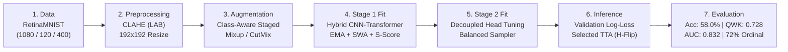

# 🩺 Lightweight Hybrid CNN–Transformer for Imbalanced Diabetic Retinopathy Grading on RetinaMNIST

[](https://www.python.org/)
[](https://pytorch.org/)
[-4CAF50.svg)](https://medmnist.com/)
[](https://opensource.org/licenses/MIT)
[](https://www.bubt.edu.bd/)
[-00A86B.svg)](https://www.bubt.edu.bd/)

Official implementation and presentation materials for the research paper:  
**"Lightweight Hybrid CNN–Transformer for Imbalanced Diabetic Retinopathy Grading on RetinaMNIST"**  
Presented at the **BUBT Computer Vision Competition Poster Session 2026**, organized by the **BUBT Research Graduate School (BRGS)**, Bangladesh University of Business and Technology.

---

## 👨‍💻 Author & Supervisor

### 👤 Author
- **Name:** [Md Shirajul Islam](https://github.com/mdshirajulislam)
- **Role:** Lead Researcher & Developer
- **Department:** Department of Computer Science and Engineering (CSE)
- **Institution:** Bangladesh University of Business and Technology (BUBT), Dhaka, Bangladesh
- **Email:** [`sirajul.cpp@gmail.com`](mailto:sirajul.cpp@gmail.com)
- **GitHub:** [@mdshirajulislam](https://github.com/mdshirajulislam)

### 🎓 Research Supervisor
- **Name:** [Md. Darun Nayeem](https://scholar.google.com/citations?user=QvG2fyIAAAAJ)
- **Role:** Research Supervisor
- **Department:** Department of Computer Science and Engineering (CSE)
- **Institution:** Bangladesh University of Business and Technology (BUBT), Dhaka, Bangladesh
- **Google Scholar:** [Citations & Publications Profile](https://scholar.google.com/citations?user=QvG2fyIAAAAJ)

---

## 📑 Table of Contents

- [Overview & Abstract](#-overview--abstract)
- [Key Highlights & Performance](#-key-highlights--performance)
- [System Architecture](#-system-architecture)
- [Experimental Results](#-experimental-results)
  - [Benchmark Comparison](#benchmark-comparison-vs-medmnist-v2-baselines)
  - [Per-Class Breakdown](#per-class-test-set-performance)
  - [Ordinal Error Distribution](#ordinal-error-distribution)
- [Repository Structure](#-repository-structure)
- [Quick Start & Usage](#-quick-start--usage)
  - [1. Environment Setup](#1-environment-setup)
  - [2. Running the Jupyter / Kaggle Notebook](#2-running-the-jupyter--kaggle-notebook)
  - [3. Modular Training via CLI](#3-modular-training-via-cli)
- [Paper, Poster & LaTeX Source](#-paper-poster--latex-source)
- [Citation](#-citation)
- [Acknowledgments](#-acknowledgments)

---

## 🔬 Overview & Abstract

Diabetic Retinopathy (DR) grading from retinal fundus photographs is a challenging five-class ordinal classification problem ($0$: No DR, $1$: Mild, $2$: Moderate, $3$: Severe, $4$: Proliferative DR). Discriminating early, subtle microvascular lesions requires fine-grained high-resolution texture extraction, while overall grading depends on broad retinal lesion distribution. Furthermore, biomedical datasets exhibit severe long-tailed class imbalance (e.g., in RetinaMNIST, Grade 0 has $486$ images while Grade 4 has only $66$).

This repository delivers an end-to-end reproducible system comprising:
1. **CLAHE-based Preprocessing:** Contrast enhancement on the $L$-channel in CIELAB color space at $192 \times 192$ resolution.
2. **Lightweight Hybrid Architecture (7.99M Parameters):** Integrates a depthwise-separable squeeze-and-excitation (DW-SE) CNN stem, an Adaptive Self-Attention Block (ABlock) with dynamic top-$k$ head gating and Ghost modules, and 4 linear-attention Transformer encoder blocks (LiteBlocks) with 2D sinusoidal embeddings.
3. **Imbalance- and Ordinality-Aware Training Recipe:** Class-balanced effective number of sample weighting with bounded ratios, an ordinal-smoothed focal loss ($\gamma=1.5, \varepsilon=0.07$), staged Mixup/CutMix schedules, EMA and SWA weight averaging, smoothed checkpoint selection, decoupled classifier head fine-tuning, and validation-guided Test-Time Augmentation (TTA).

On the held-out $400$-image RetinaMNIST test set, the system achieves **$58.0\%$ Accuracy**, **$0.728$ Quadratic Weighted Kappa (QWK)**, and **$0.832$ Macro-AUC (OvR)**, with **$72.0\%$ of all errors confined to adjacent grades**.

---

## 🚀 Key Highlights & Performance

| Metric | MedMNIST v2 Best Baseline (Google AutoML) | Our Proposed System | Improvement |
| :--- | :---: | :---: | :---: |
| **Accuracy (ACC)** | 53.1% (0.531) | **58.0% (0.580)** | **+4.9%** 📈 |
| **Area Under ROC (AUC)** | 0.750 | **0.832** | **+0.082** 📈 |
| **Quadratic Weighted Kappa (QWK)** | — | **0.728** | *Clinically ordered* |
| **Model Footprint** | Heavy / Cloud | **7.99M Parameters** | *~68% of ResNet-18* |
| **Training Speed** | — | **~17 sec / epoch** | *Full run in < 40 min* |
| **Ordinal Adjacent Errors** | — | **72.0% (121/168)** | *Clinically benign* |
| **Referable DR Sensitivity / Specificity** | — | **76.7% / 86.4%** | *Binary Acc: 82.0%* |

---

## 🏗 System Architecture

```
Input (3 x 192 x 192)
  │  [CLAHE (LAB) + Normalization]
  ▼
Stage-1 CNN (DW-SE Inverted Residuals, base=64) ──► Output: 256 x 24 x 24
  │  [2D Channel Dropout p=0.05]
  ▼
ABlock (DW-SE + 8-Head Top-4 Gated Attention + Ghost Module) ──► Output: 256 x 6 x 6
  │
  ▼
Patch Embedding (2x2 Patch Conv + LN + 2D Sin-Cos Position) ──► 9 tokens x 256-d
  │
  ▼
4x LiteBlocks (Pre-LN Linear Attention φ(x)=ELU(x)+1 + SiLU FFN) ──► 9 tokens x 256-d
  │
  ▼
Token Pooling (Mean Pooling ⊕ Max Pooling) ──► 256-d Vector
  │
  ▼
Classification Head (LN + SiLU + Dropout MLP: 256 → 256 → 128 → 5) ──► 5 Grade Logits
```

### End-to-End Pipeline Workflow



---

## 📊 Experimental Results

### Training Convergence, Validation Progression & Test Confusion Matrix


*(a) Training loss and EMA validation loss showing steady convergence (best epoch: 79). (b) Progression of validation metrics. (c) Confusion matrix on the 400-image test set demonstrating strong diagonal and sub-diagonal concentration.*

---

### Benchmark Comparison vs MedMNIST v2 Baselines

Evaluation on the official held-out test split of RetinaMNIST:

| Model | Input Size | Parameters | Test AUC | Test Accuracy |
| :--- | :---: | :---: | :---: | :---: |
| ResNet-18 | $28 \times 28$ | ~11.2M | 0.717 | 0.524 |
| ResNet-18 | $224 \times 224$ | ~11.7M | 0.710 | 0.493 |
| ResNet-50 | $28 \times 28$ | ~23.5M | 0.726 | 0.528 |
| Google AutoML Vision | $224 \times 224$ | Cloud | 0.750 | 0.531 |
| **Proposed Hybrid Net (Ours)** | $\mathbf{192 \times 192}$ | **7.99M** | **0.832** | **0.580** |

---

### Per-Class Test Set Performance

| DR Severity Grade | Precision | Recall | F1-Score | Support (Images) |
| :--- | :---: | :---: | :---: | :---: |
| **Grade 0 (No DR)** | 0.839 | 0.718 | **0.774** | 174 |
| **Grade 1 (Mild DR)** | 0.301 | 0.543 | **0.388** | 46 |
| **Grade 2 (Moderate DR)** | 0.427 | 0.413 | **0.420** | 92 |
| **Grade 3 (Severe DR)** | 0.581 | 0.529 | **0.554** | 68 |
| **Grade 4 (Proliferative DR)**| 0.471 | 0.400 | **0.432** | 20 |
| **Macro Average** | **0.524** | **0.521** | **0.514** | **400** |
| **Weighted Average** | **0.620** | **0.580** | **0.594** | **400** |

---

### Ordinal Error Distribution

Because Diabetic Retinopathy severity is progressive, misclassifying by one adjacent grade is far less severe in clinical triage than multi-grade discrepancies:

- **Off by 0 grades (Correct predictions):** $232 / 400$ ($58.0\%$)
- **Off by 1 grade (Adjacent error):** $121 / 168$ ($72.0\%$ of errors)
- **Off by 2 grades:** $40 / 168$ ($23.8\%$ of errors)
- **Off by 3–4 grades:** $7 / 168$ ($4.2\%$ of errors)

---

## 📁 Repository Structure

```
BUBT-Computer-Vision-competition/
├── README.md                            # Comprehensive project overview and documentation
├── requirements.txt                     # Python dependencies
├── LICENSE                              # MIT License
├── .gitignore                           # Git ignore rules for PyTorch, LaTeX, checkpoints
│
├── paper/                               # System paper publication materials
│   ├── Md_Shirajul_Islam_System_paper.pdf # Complete compiled research paper (5 pages)
│   └── latex/                           # Overleaf LaTeX project source files
│       ├── Paper_RetinaMNIST_5page.tex  # Full LaTeX manuscript
│       ├── results.pdf                  # Vector figures used in LaTeX
│       └── overleaf_source.zip          # Complete archive for 1-click Overleaf import
│
├── poster/                              # Conference poster session materials
│   └── Md_Shirajul_Islam_Poster.pdf     # High-resolution presentation poster
│
├── notebooks/                           # Interactive experimental code
│   └── cv-02-md-shirajul-islam.ipynb    # Complete Kaggle / Colab / Jupyter notebook
│
├── src/                                 # Modular, reusable Python package
│   ├── __init__.py                      # Package entry point
│   ├── model.py                         # Hybrid CNN-Transformer architecture (7.99M params)
│   ├── dataset.py                       # CLAHE preprocessing, transforms, loaders
│   ├── loss.py                          # Class-balanced weights & Ordinal Focal Loss
│   └── train.py                         # Complete training, decoupled head & TTA pipeline
│
└── assets/                              # Previews and graphical assets
    ├── results.png                      # High-res training plots & confusion matrix
    ├── poster_preview.png               # Poster preview
    └── paper_preview.png                # Paper front page preview
```

---

## ⚡ Quick Start & Usage

### 1. Environment Setup

Clone the repository and install requirements:

```bash
git clone https://github.com/mdshirajulislam/BUBT-Computer-Vision-competition.git
cd BUBT-Computer-Vision-competition

python -m venv venv
# On Windows:
venv\Scripts\activate
# On Linux/macOS:
source venv/bin/activate

pip install -r requirements.txt
```

### 2. Running the Jupyter / Kaggle Notebook

To inspect the self-contained notebook with all training outputs, metrics, and logs:

```bash
jupyter notebook notebooks/cv-02-md-shirajul-islam.ipynb
```
*The notebook automatically downloads the official RetinaMNIST dataset via the `medmnist` library and runs on standard GPUs.*

### 3. Modular Training via CLI

To train the complete two-stage model from scratch:

```bash
python -m src.train --seed 42 --epochs 150 --batch-size 32 --lr 2e-4 --img-size 192 --eval-test
```

Options:
- `--seed`: Deterministic random seed (default: `42`).
- `--epochs`: Maximum number of epochs (default: `150`, early stopping patience: `35`).
- `--batch-size`: Batch size (default: `32`).
- `--lr`: Initial AdamW peak learning rate (default: `2e-4`).
- `--eval-test`: Runs validation TTA selection and evaluates on the 400-image held-out test set.

---

## 📄 Paper, Poster & LaTeX Source

| Asset | Preview | Description & Link |
| :--- | :---: | :--- |
| **System Paper** |  | **[Download Paper (PDF)](paper/Md_Shirajul_Islam_System_paper.pdf)**<br>Full 5-page research paper detailing methodology, theoretical formulations, and limitations. |
| **Presentation Poster** |  | **[Download Poster (PDF)](poster/Md_Shirajul_Islam_Poster.pdf)**<br>Presented at the BUBT Computer Vision Competition Poster Session 2026. |
| **Overleaf LaTeX Code** | 📝 | **[View LaTeX Source](paper/latex/Paper_RetinaMNIST_5page.tex)** or **[Download Overleaf ZIP](paper/latex/overleaf_source.zip)**<br>Ready to import directly into Overleaf for reproduction or compilation. |

---

## 📜 Citation

If you find this work or codebase helpful in your research, please cite:

```bibtex
@inproceedings{islam2026retinamnist,
  title     = {Lightweight Hybrid CNN--Transformer for Imbalanced Diabetic Retinopathy Grading on RetinaMNIST},
  author    = {Md Shirajul Islam},
  booktitle = {Proceedings of the BUBT Computer Vision Competition Poster Session},
  year      = {2026},
  address   = {Dhaka, Bangladesh},
  note      = {Organized by BUBT Research Graduate School (BRGS); Supervised by Md. Darun Nayeem}
}
```

---

## 🙏 Acknowledgments

- **BUBT Research Graduate School (BRGS)** for organizing the Computer Vision Competition 2026.
- **Department of Computer Science and Engineering (CSE), BUBT** for academic facilities and support.
- **Md. Darun Nayeem** for continuous mentorship and valuable feedback.
- The **MedMNIST** research team for providing the standardized RetinaMNIST benchmark.

---

<div align="center">
  <b>Developed with ❤️ by <a href="https://github.com/mdshirajulislam">Md Shirajul Islam</a></b>
</div>
